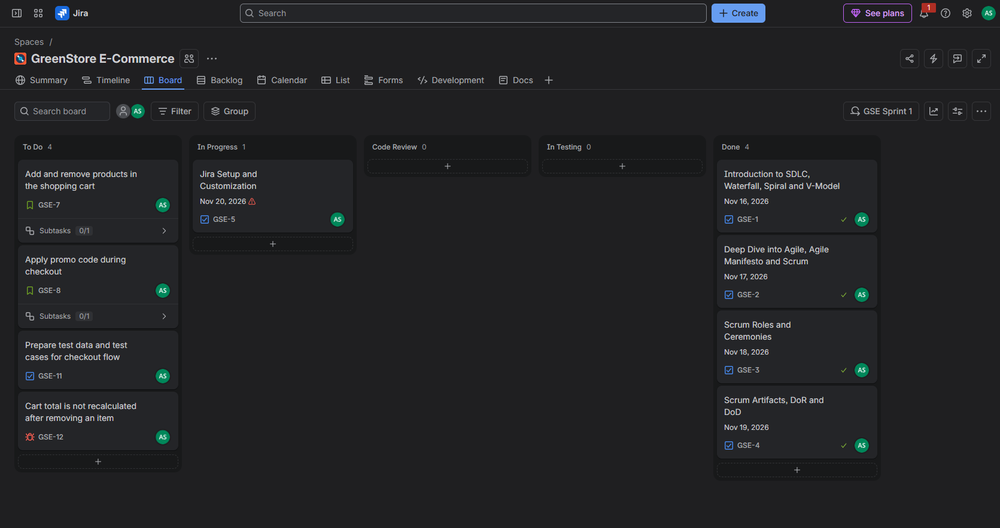

# 📘 День 05: Налаштування та кастомізація Jira

---

## 🧠 1. Теоретична частина

### Ієрархія типів задач у Jira (Issue Types)
У Jira кожна одиниця роботи називається *Issue* (задача або тікет). Щоб команда не губилася в масштабі робіт, задачі вибудовуються в ієрархію від великих цілей до конкретних кроків: **Epic** → **Story / Task / Bug** → **Sub-task**.

1. **Epic (Епік)**
   * **Суть:** Велика бізнес-фіча або модуль продукту, який не виконується за один спринт і виступає контейнером для пов'язаних історій та задач.
   * **Приклад:** *«Модуль авторизації та реєстрації користувачів»* або *«Система оплати замовлень»*.
   * **Роль QA:** Оцінює загальний обсяг тестування модуля, планує структуру тестових наборів (*Test Suites*) та стежить за готовністю великої фічі.

2. **User Story (Користувацька історія)**
   * **Суть:** Опис функціональності з позиції кінцевого користувача з чіткою бізнес-цінністю в межах одного спринту.
   * **Приклад:** *«Як зареєстрований користувач, я хочу увійти в акаунт за email і паролем, щоб отримати доступ до історії замовлень»*.
   * **Роль QA:** Перевіряє історію на відповідність *DoR* перед стартом спринту, формує тест-кейси/чек-лісти та виконує фінальну перевірку за *DoD*.

3. **Task (Задача)**
   * **Суть:** Технічна або організаційна робота, потрібна для розробки чи релізу, навіть без прямої візуальної зміни для кінцевого користувача.
   * **Приклад:** *«Налаштувати тестовий стенд»*, *«Оновити версію бази даних»*, *«Написати автотести для API кошика»*.
   * **Роль QA:** Створює такі задачі для власної роботи (підготовка тестових даних, налаштування проксі або оновлення тестової документації).

4. **Bug (Дефект / Баг)**
   * **Суть:** Невідповідність фактичної поведінки системи очікуваній (за вимогами, макетами або логікою роботи).
   * **Приклад:** *«При натисканні кнопки "Увійти" з порожнім полем пароля повертається помилка 500 замість повідомлення валідації»*.
   * **Роль QA:** Фіксує баг-репорт з кроками відтворення, вкладеннями/логами та виконує повторну перевірку (*Retest*) після виправлення.

5. **Sub-task (Підзадача)**
   * **Суть:** Деталізація *Story*, *Task* або *Bug* на менші кроки для різних учасників у межах батьківського тікета (у стандартній схемі створюється всередині *Story / Task / Bug*, а не напряму в *Epic*).
   * **Приклад:** Усередині *Story* *«Форма входу»* — підзадачі на верстку (*Frontend*), *API* (*Backend*) та перевірку (*QA*).

---

### Робочий процес (Workflow) та кастомізація дошки
*Workflow* визначає життєвий цикл задачі через послідовність статусів (колонок) і переходів між ними. Базової схеми з трьох колонок (*To Do → In Progress → Done*) зазвичай бракує, оскільки в ній не відокремлено етап тестування.

* **To Do (До виконання):** Задачі, готові до взяття в роботу та перевірені за *DoR*.
* **In Progress (У роботі):** Активна реалізація задачі.
* **Code Review:** Перевірка коду іншим розробником перед злиттям та деплоєм на тестове середовище.
* **In Testing (У тестуванні):** Перевірка задачі тестувальником на тестовому стенді (за потреби разом із чергою *Ready for QA* для уникнення дублювання роботи між QA).
* **Done (Готово):** Задачу перевірено за *DoD*, зауважень немає і вона готова до релізу.
* **Блокування та повернення:** Заблоковані задачі позначають статусом або прапорцем (*Flagged*) із поясненням причини, а при виявленні дефекту повертають у роботу (*In Progress* або *Reopened*).

---

### 📊 Порівняльна таблиця: Scrum-дошка vs Kanban-дошка в Jira

| Критерій | Scrum Project у Jira | Kanban Project у Jira |
| :--- | :--- | :--- |
| **Організація роботи** | Фіксовані ітерації — спринти (зазвичай 1–4 тижні) | Безперервний потік задач без прив'язки до спринтів |
| **Фокус планування** | Відбір задач на спринт та *Sprint Goal* | Керування поточним завантаженням і пропускною спроможністю потоку |
| **Звітність і метрики** | *Sprint Burndown / Velocity* по завершених спринтах | *Cycle Time / Lead Time* та контроль черг на етапах |

---

## 🛠️ 2. Практична частина: Налаштування дошки `GreenStore E-Commerce` (`GSE`)

* **Конфігурація робочого простору:** Для практики використано проєкт **GreenStore E-Commerce** (`GSE`) з англомовним інтерфейсом (`English (US)`) та оформленим профілем учасника (*Andrew Sukhinin*, `AS`).
* **Кастомізація дошки та спринту:** Налаштовано колонки *To Do*, *In Progress*, *Code Review*, *In Testing* та *Done* у межах *GSE Sprint 1*, а також структуровано картки різних типів (зокрема `GSE-7`, `GSE-8`, `GSE-11`, `GSE-12` у *To Do*, `GSE-5` у *In Progress* та виконані картки `GSE-1`–`GSE-4` у *Done*).

---

## 💼 3. Запитання на співбесіді

<b>У чому різниця між Epic, User Story та Task у Jira?</b>

<b>Epic</b> — це великий функціональний блок або модуль, який охоплює кілька спринтів. <b>User Story</b> описує цінність для користувача в межах одного спринту, а <b>Task</b> — це технічна або організаційна задача (наприклад, налаштування стенду чи тестових даних), яка підтримує роботу команди.

<b>Чому на реальній QA-дошці зазвичай розширюють стандартний workflow з 3 колонок?</b>

У схемі з трьох колонок не видно, де саме перебуває задача — на рев'ю коду, чекає на деплой на тестовий стенд чи вже перевіряється QA. Додаткові колонки роблять статус прозорим і знижують ризик пропустити тестування або випадково закрити задачу раніше часу.

<b>Чи можна створити Sub-task безпосередньо всередині Epic у стандартній ієрархії Jira?</b>

У стандартній ієрархії Jira підзадачі створюються всередині <b>Story</b>, <b>Task</b> або <b>Bug</b> для розбиття конкретної задачі на дрібні кроки, а не безпосередньо в <b>Epic</b>.

<b>Як у роботі QA відрізняється Bug від Task, якщо функціонал працює не так, як очікувалося?</b>

<b>Bug</b> фіксує невідповідність фактичної поведінки системи очікуваній (вимогам, макетам або логіці). <b>Task</b> описує планову технічну чи організаційну роботу (наприклад, рефакторинг, оновлення оточення або підготовку тестових даних), а не дефект наявної поведінки.

<b>У чому ключова різниця між Scrum-дошкою та Kanban-дошкою в Jira?</b>

<b>Scrum-дошка</b> орієнтована на фіксовані ітерації (спринти) із заданою <i>Sprint Goal</i> та метриками на кшталт <i>Velocity</i> чи <i>Burndown</i>. <b>Kanban-дошка</b> працює як безперервний потік задач без спринтів із фокусом на поточний обсяг робіт у процесі та швидкість проходження задач (<i>Cycle Time / Lead Time</i>).

<b>Навіщо в робочому процесі відокремлювати етап тестування та фіксувати блокування задач?</b>

Окремий етап тестування чітко показує, чи готова задача до перевірки QA і чи йде вона зараз, а позначка блокування (статус або <i>Flagged</i> із коментарем) одразу сигналізує команді, що рух задачі зупинено через зовнішню залежність або критичну проблему.

